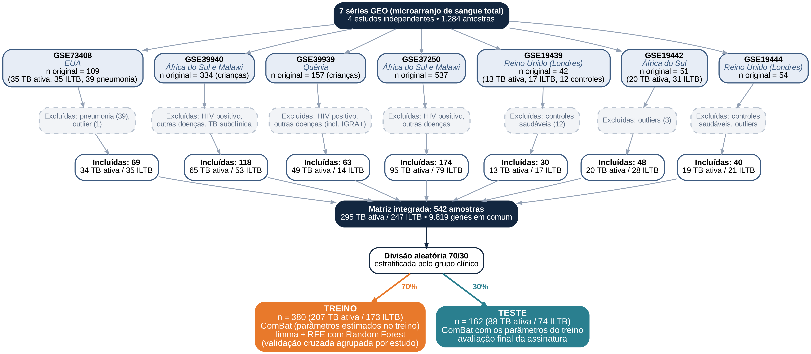
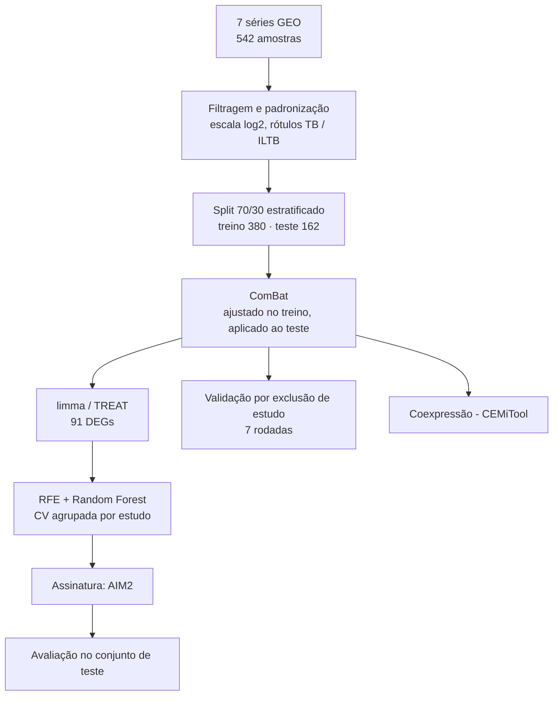
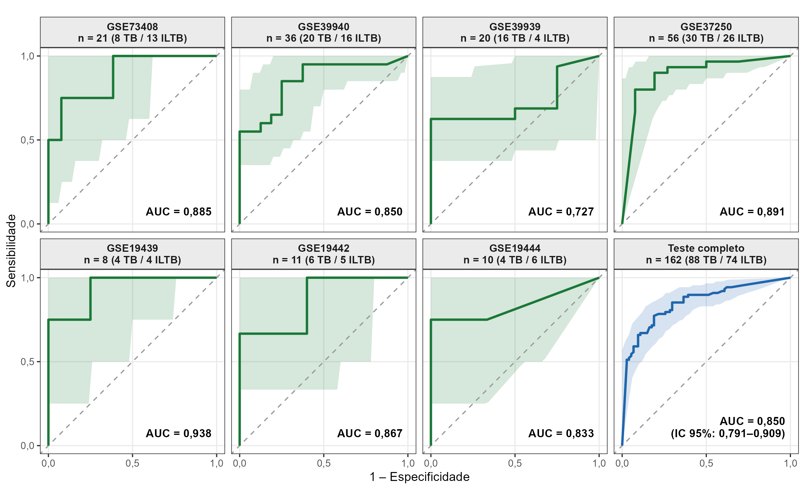
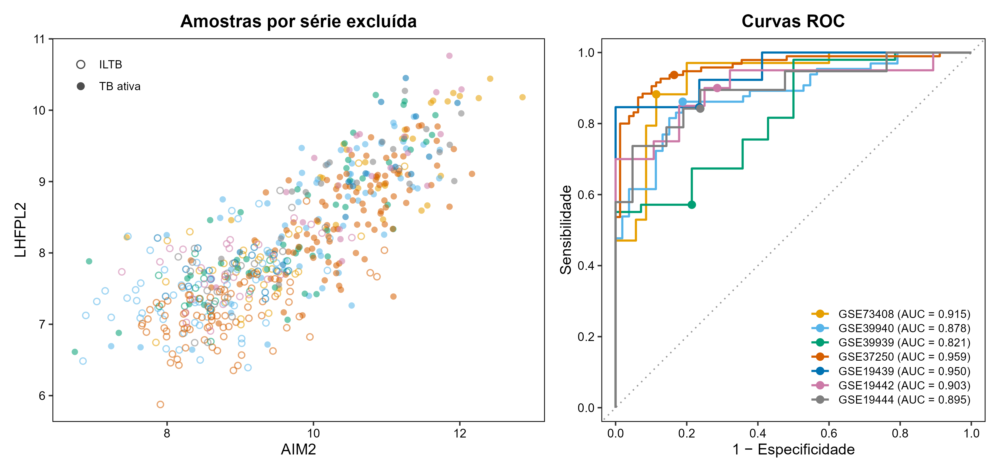
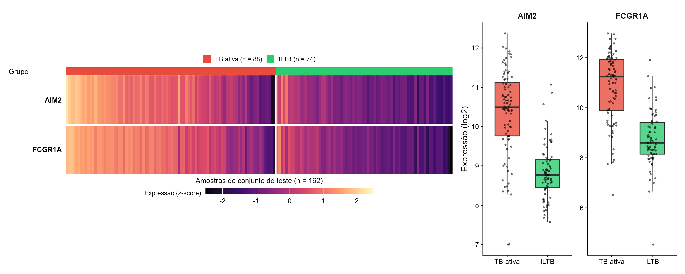

# Identificação de assinatura transcriptômica em sangue total para diferenciação entre tuberculose ativa e infecção latente: validação em múltiplas coortes

Código do Trabalho de Conclusão de Curso **"Identificação de assinatura transcriptômica em sangue total para diferenciação entre tuberculose ativa e infecção latente: validação em múltiplas coortes"**, Bacharelado em Biotecnologia, Instituto de Ciências da Saúde, Universidade Federal da Bahia (2026).

**Autor:** Gustavo Pires Ramos Cerqueira dos Santos
**Orientação:** Dra. Mariana Araújo-Pereira (Instituto Gonçalo Moniz – Fiocruz Bahia)
**Coorientação:** Isabella Brige Ferreira

---

## Resumo

Os testes usados hoje (teste tuberculínico e IGRA) indicam infecção pelo *Mycobacterium tuberculosis*, mas não distinguem a infecção latente (ILTB) da tuberculose ativa (TB). Este trabalho integrou sete séries públicas de microarranjo de sangue total do GEO (542 amostras: 295 TB ativa e 247 ILTB) para identificar uma assinatura mínima capaz de separar os dois estados e testar se ela se mantém entre coortes diferentes.

O gene **AIM2** foi selecionado como assinatura de um único gene e obteve **AUC de 0,850** no conjunto de teste. Na validação por exclusão de estudo, a assinatura de consenso **AIM2 + LHFPL2** alcançou **AUC média de 0,903** nas séries deixadas de fora.

## Dados

| Série | País | Plataforma | Amostras incluídas (TB / ILTB) |
|---|---|---|---|
| GSE73408 | EUA | Affymetrix | 69 (34 / 35) |
| GSE39940 | África do Sul e Malawi (crianças) | Illumina HT-12 V4 | 118 (65 / 53) |
| GSE39939 | Quênia (crianças) | Illumina HT-12 V4 | 63 (49 / 14) |
| GSE37250 | África do Sul e Malawi | Illumina HT-12 V4 | 174 (95 / 79) |
| GSE19439 | Reino Unido | Illumina HT-12 V3 | 30 (13 / 17) |
| GSE19442 | África do Sul | Illumina HT-12 V3 | 48 (20 / 28) |
| GSE19444 | Reino Unido | Illumina HT-12 V3 | 40 (19 / 21) |

Foram excluídas pessoas vivendo com HIV, outras doenças (incluindo pneumonia), TB subclínica e controles saudáveis.



Os dados brutos não estão neste repositório. Eles podem ser baixados diretamente do [GEO](https://www.ncbi.nlm.nih.gov/geo/) pelos códigos acima.

## Pipeline



1. **Pré-processamento:** cada série foi mantida na normalização dos estudos originais e convertida para log2 quando necessário. As sondas foram agrupadas por símbolo de gene.
2. **Correção de lote:** ComBat paramétrico com parâmetros estimados só no treino e aplicados ao teste, sem usar os rótulos clínicos.
3. **Expressão diferencial:** limma com TREAT (|log2FC| > 1, FDR < 0,05), só com as amostras de treino.
4. **Seleção da assinatura:** eliminação recursiva de atributos (RFE) com Random Forest, sob validação cruzada em que cada rodada deixa uma série inteira de fora. O menor conjunto com desempenho próximo ao máximo foi comparado com outros candidatos, e o modelo final passou por um teste de permutação (100 rodadas).
5. **Teste:** probabilidade de TB ativa com limiar de 0,5 no conjunto de teste completo e em cada série.
6. **Validação por exclusão de estudo (LODO):** em cada rodada, uma série inteira fica fora da correção de lote, dos DEGs e da seleção de genes, e é usada só para avaliação.
7. **Coexpressão:** módulos do CEMiTool e GSEA entre TB ativa e ILTB.

## Resultados

| Análise | Resultado |
|---|---|
| Genes diferencialmente expressos | 91 (70 aumentados e 21 diminuídos na TB ativa) |
| Vias enriquecidas | Sinalização por interferon e degranulação de neutrófilos (aumentados); ativação do receptor de células B (diminuídos) |
| Assinatura selecionada | AIM2 (1 gene) |
| Conjunto de teste | AUC 0,850 · sensibilidade 0,807 · especificidade 0,716 |
| LODO, 1ª etapa (seleção independente por rodada) | AUC média 0,885 |
| LODO, 2ª etapa (consenso AIM2 + LHFPL2) | AUC média 0,903 (0,821 a 0,959) |
| Coexpressão | Módulos de neutrófilos (M1) e interferon (M4) ativados; módulos de linfócitos T/B (M2) e células citotóxicas/NK (M6) reprimidos na TB ativa |

<p align="center">
  
  
</p>

<p align="center">
  
</p>

## Limitações

- O conjunto de teste veio das mesmas séries usadas no treino. A validação por exclusão de estudo se aproxima de uma validação externa, mas a assinatura de consenso foi definida a partir de todas as rodadas.
- A sensibilidade no teste (0,807) ficou abaixo do mínimo de 90% recomendado pela OMS para um teste de triagem.
- Os dados são retrospectivos, de populações e critérios diagnósticos heterogêneos, e não incluem a população brasileira.

## Estrutura do repositório

```
.
├── README.md
├── scripts/
│   └── TB_assinatura_abordagemA.R   # pipeline completo, comentado por etapa
└── figuras/                         # figuras geradas pelo script
```

## Como reproduzir

Requer R 4.5.2. Pacotes principais: `sva`, `limma`, `caret`, `randomForest`, `pROC`, `clusterProfiler`, `ReactomePA`, `org.Hs.eg.db`, `CEMiTool`, `ggplot2`, `patchwork`, `openxlsx`.

O script lê um arquivo `.xlsx` por série em `R/meta/` (aba de expressão + aba de metadados). Ele deve ser rodado de cima para baixo, numa mesma sessão; os blocos finais (validação, CEMiTool e figuras) usam objetos criados nas etapas anteriores. Todas as etapas aleatórias usam `set.seed(42)`.
